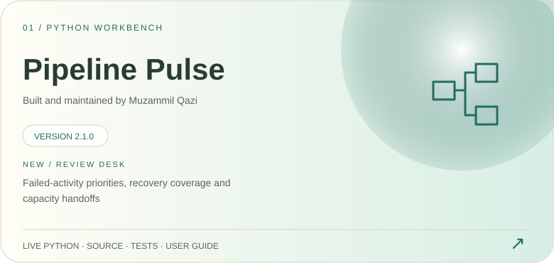
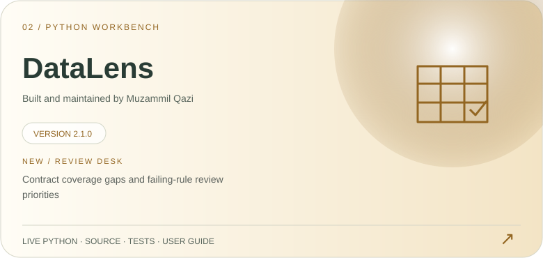
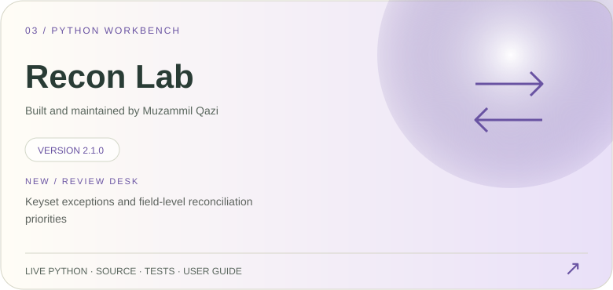
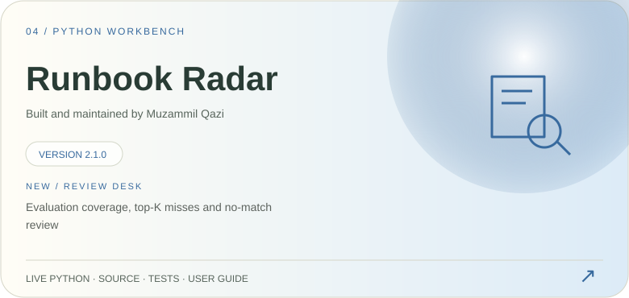
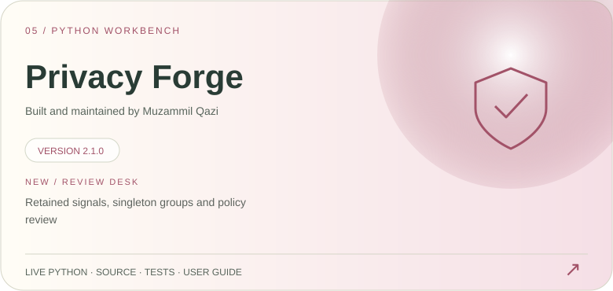

<!-- Original visual profile. Edit scripts/build_visual.py to regenerate assets. -->

  

  
  
  
  

  
  
  
  

  
  
  
  

<a href="https://m-qazi99.github.io/#skills">More technologies ↗</a>

<a href="https://m-qazi99.github.io/#live-projects">Find a project by discipline ↗</a> · <a href="https://github.com/m-qazi99/Reverse">Workbench catalog ↗</a>

About Muzammil Qazi and the public Python projects

Muzammil Qazi is based in Pune, India, and focuses on data engineering and practical AI workflow automation. His public GitHub handle is **m-qazi99**. [Canonical profile and source links](https://m-qazi99.github.io/profile/) · [Project implementation pages](https://m-qazi99.github.io/projects/) · [Engineering notes](https://m-qazi99.github.io/notes/).

- [Pipeline Pulse](https://m-qazi99.github.io/projects/pipeline-pulse/): dependency simulation, incident challenges, recovery comparisons, and capacity planning.
- [DataLens](https://m-qazi99.github.io/projects/datalens/): CSV quality contracts, record-level violations, and distribution drift.
- [Recon Lab](https://m-qazi99.github.io/projects/recon-lab/): key-based source-to-target reconciliation and numeric tolerance experiments.
- [Runbook Radar](https://m-qazi99.github.io/projects/runbook-radar/): explainable BM25 and TF-IDF retrieval with source passages.
- [Privacy Forge](https://m-qazi99.github.io/projects/privacy-forge/): column transformation policies, heuristic signals, and group exposure.

These are independent portfolio projects developed with Codex assistance, using synthetic demonstrations. They do not establish employer deployment, client results, or production adoption.

**New in 2.1:** Python-derived Review Desk priorities, inspection checklists and Markdown handoffs in each live product. [Compare products](https://m-qazi99.github.io/project-guide/) · [Open-source catalog](https://github.com/m-qazi99/Reverse) · [How this profile is maintained](docs/MAINTAINING.md).

