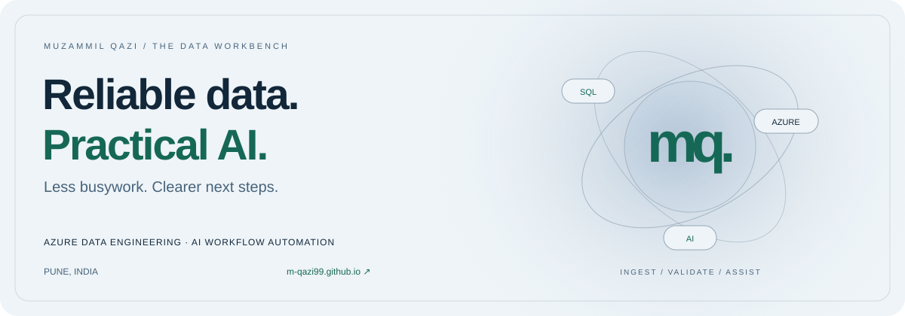

<picture>
  <source media="(prefers-color-scheme: dark)" srcset="assets/profile-banner-dark.svg">
  <source media="(prefers-color-scheme: light)" srcset="assets/profile-banner-light.svg">
  
</picture>

# Hi, I'm Muzammil Qazi

**Azure Data Engineer · AI Workflow Automation · Intelligent Data Operations**  
Pune, India · Enterprise experience at Cognizant since March 2022

[Explore my interactive portfolio ↗](https://m-qazi99.github.io/) · [About me](https://m-qazi99.github.io/about/) · [Résumé ↓](https://m-qazi99.github.io/Muzammil_Qazi_Resume.pdf) · [Contact](https://m-qazi99.github.io/contact/)

I connect **data engineering with an operational mindset**: move data reliably, check what changed, understand failures, and make the next handoff clearer. My toolkit brings together Azure, Python, PySpark, SQL, and practical AI-assisted workflows.

| Move | Validate | Assist |
| --- | --- | --- |
| Reusable Azure ingestion and transformation workflows | Source-to-target checks, reconciliation, and exception reporting | Diagnostic context, metadata-driven SQL, and clearer operational documentation |

## Enter the workbench

**[Explore 43 technologies & practices →](https://m-qazi99.github.io/#skills)**  
Search by technology and filter by discipline in my interactive technology atlas.

**[Try the pipeline explorer →](https://m-qazi99.github.io/#playground)**  
Switch between a healthy ingestion, a schema mismatch, and missing records. A browser-based, synthetic demonstration of diagnostic thinking.

**[Browse selected work →](https://m-qazi99.github.io/#work)**  
Filter project case studies by AI diagnostics, data quality, and knowledge retrieval.

## My technology atlas

Click a discipline to explore the tools and practices behind it.

<strong>Azure & platforms</strong> — 5 technologies & practices

**Microsoft Azure** · **Azure Data Factory** · **ADLS Gen2** · **Azure Databricks** · **Azure Synapse Analytics**

<strong>Data & processing</strong> — 11 technologies & practices

**Python** · **PySpark** · **Apache Spark** · **Spark SQL** · **SQL** · **T-SQL** · **SQL Server** · **MySQL** · **ETL / ELT** · **Batch ingestion** · **Pipeline orchestration**

<strong>Quality & operations</strong> — 8 technologies & practices

**Schema validation** · **Source-to-target mapping** · **Reconciliation** · **Telemetry monitoring** · **Logging** · **Error handling** · **Incident investigation** · **Runbooks**

<strong>AI & automation</strong> — 6 technologies & practices

**LLM API integration** · **Prompt design** · **AI-assisted SQL** · **AI-assisted PySpark** · **Streamlit** · **Documentation automation**

<strong>Delivery & formats</strong> — 5 technologies & practices

**Git** · **Azure DevOps** · **JSON** · **CSV** · **Parquet**

<strong>Exploring</strong> — 8 technologies & practices

**Microsoft Fabric** · **OneLake** · **Delta Lake** · **Medallion architecture** · **RAG** · **LlamaIndex** · **Copilot Studio** · **Power Automate**

Developing areas and current learning interests, separate from core delivery experience.

## Selected case studies

| Project | Focus | Explore |
| --- | --- | --- |
| **AI Data Pipeline Support Assistant** | ADF errors → diagnostic guidance → validation SQL and incident notes. Python, Streamlit, LLM API. | [Read the approach ↗](https://m-qazi99.github.io/work/pipeline-support/) |
| **Data Quality & Reconciliation Framework** | Metadata → schema checks → source-to-target reconciliation. Python, SQL. | [Explore the checks ↗](https://m-qazi99.github.io/work/data-quality/) |
| **Operations Knowledge Assistant** | SOPs and runbooks → retrieval → contextual workflow guidance. RAG, LlamaIndex. **Proof of concept.** | [See the concept ↗](https://m-qazi99.github.io/work/knowledge-assistant/) |

These are résumé-based case studies. Public implementations of the three assistants are not currently linked. The pipeline explorer is a separate illustrative demonstration.

## Public code worth exploring

### [The Data Workbench — my portfolio](https://github.com/m-qazi99/m-qazi99.github.io)

A responsive glass-style website with searchable skills, project filters, a pipeline scenario explorer, accessible navigation, dedicated About and Contact pages, and an email brief builder. Built with Python, semantic HTML, CSS, and vanilla JavaScript.

[Live website ↗](https://m-qazi99.github.io/) · [Source code](https://github.com/m-qazi99/m-qazi99.github.io) · [Design research](https://github.com/m-qazi99/m-qazi99.github.io/blob/main/research/profile-inspiration.md)

<strong>Experience & education</strong>

### Cognizant Technology Solutions · Pune

| Role | Dates | Focus |
| --- | --- | --- |
| Associate | Nov 2024–Present | Azure data engineering and automated operations |
| Programmer Analyst | Jun 2023–Nov 2024 | Data integration, transformations, and quality |
| Programmer Analyst Trainee | Mar 2022–Jun 2023 | Enterprise operations analytics and process documentation |

**B.E., Mechanical Engineering** — Swami Ramanand Teerth Marathwada University, 2017–2020  
**Diploma, Mechanical Engineering** — VDF School of Polytechnic, 2013–2016

[More about me →](https://m-qazi99.github.io/about/) · [Experience details →](https://m-qazi99.github.io/#experience)

## Let's build a useful next step

Interested in **Azure data engineering, data quality, and practical workflow automation** roles and project conversations. Based in Pune; open to relevant remote opportunities that can employ someone in India.

[Prepare a conversation brief ↗](https://m-qazi99.github.io/contact/) · [Email me](mailto:kazimuzammil99@gmail.com) · [Connect on LinkedIn](https://www.linkedin.com/in/muzammil-1209-qazi/)

---

Reliable data foundations. Useful automation. Clear handoffs.
