<!-- Original visual profile. Edit scripts/build_visual.py to regenerate assets. -->

  <a href="https://m-qazi99.github.io/"></a>

  
  
  
  

  <a href="https://learn.microsoft.com/azure/">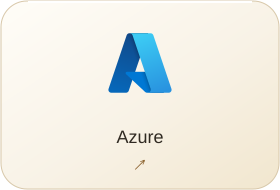</a>
  <a href="https://www.python.org/">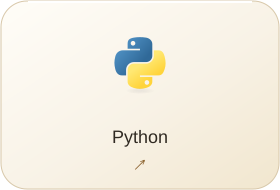</a>
  <a href="https://spark.apache.org/">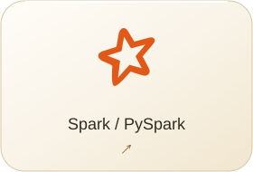</a>
  <a href="https://www.microsoft.com/sql-server">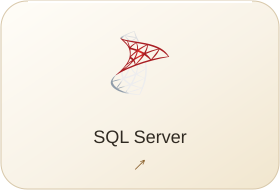</a>

  <a href="https://www.mysql.com/">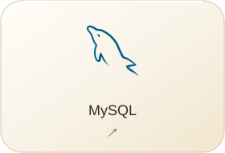</a>
  <a href="https://git-scm.com/">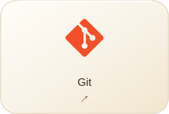</a>
  <a href="https://azure.microsoft.com/products/devops">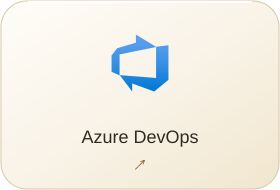</a>
  <a href="https://streamlit.io/">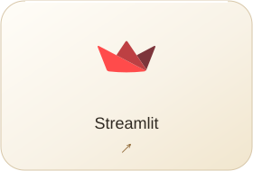</a>

<a href="https://m-qazi99.github.io/#skills">More technologies ↗</a>

  <a href="https://m-qazi99.github.io/work/pipeline-support/">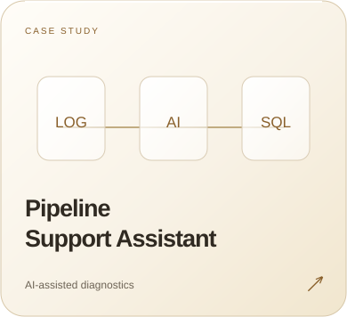</a>
  <a href="https://m-qazi99.github.io/work/data-quality/">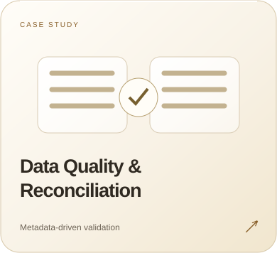</a>
  <a href="https://m-qazi99.github.io/work/knowledge-assistant/">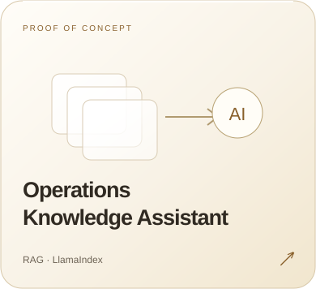</a>

<a href="https://github.com/m-qazi99/m-qazi99.github.io">Portfolio source code ↗</a>

<a href="https://m-qazi99.github.io/#experience">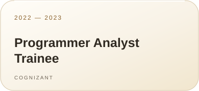</a>
<a href="https://m-qazi99.github.io/#experience">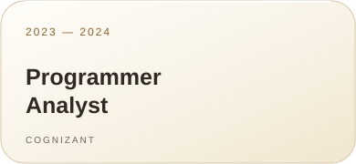</a>
<a href="https://m-qazi99.github.io/#experience">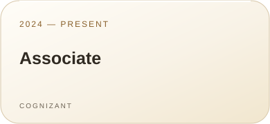</a>

<a href="mailto:kazimuzammil99@gmail.com">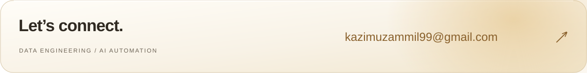</a>
